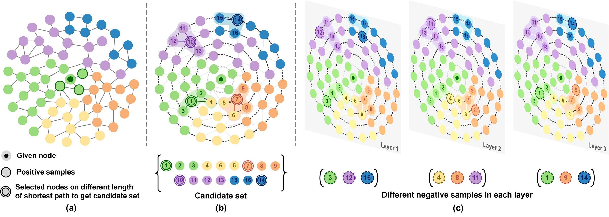

# LDGCN (Layer-diverse Negative Sampling for GNNs)

This is the official PyTorch implementation of:

**Layer-diverse Negative Sampling for Graph Neural Networks**

Wei Duan, Jie Lu, Yu Guang Wang, Junyu Xuan

*Transactions on Machine Learning Research (TMLR), 2024*

[OpenReview](https://openreview.net/forum?id=WOrdoKbxh6) | [arXiv](https://arxiv.org/abs/2403.11408)



Negative samples from layer-diverse DPP sampling. (a) For a given node in a graph, its first-order neighbours can be thought of as *positive samples*, despite the fact that these neighbours may belong to different clusters. (b) The shortest-path algorithm calculates the shortest path from a given node to other nodes in the graph to obtain smaller, yet more efficient candidate sets for further sampling. (c) As the candidate set is significantly larger than the number of negative samples needed, the ideal subset of negative samples is not unique. By using the layer-diverse DPP sampling method to select negative samples, it is possible to include as much information from the entire graph as possible while also reducing redundancy among negative samples in different layers.

## Models

| File | Backbone | Description |
| --- | --- | --- |
| `LDGCN.py` | GCN | Layer-diverse GCN (main model in the paper) |
| `LDGATV2.py` | GATv2 | Layer-diverse sampling with GATv2 |
| `LDGIN.py` | GIN | Layer-diverse sampling with GIN |
| `LDSAGE.py` | GraphSAGE | Layer-diverse sampling with GraphSAGE |

## Requirements

- Python >= 3.8
- PyTorch
- PyTorch Geometric
- NetworkX
- NumPy

```bash
pip install -r requirements.txt
```

Planetoid / Amazon / Coauthor datasets are downloaded automatically by PyTorch Geometric.

## Usage

```bash
# LDGCN on Cora (default)
python LDGCN.py --dataset Cora --sample_rate 0.1 --num_layers 4 --num_runs 10 --num_epochs 400

# Other backbones
python LDGATV2.py --dataset Cora
python LDGIN.py --dataset Cora
python LDSAGE.py --dataset Cora
```

Supported datasets: `Cora`, `Citeseer`, `Pubmed`, `Computers`, `Photo`, `CS`.

| Argument | Default | Description |
| --- | --- | --- |
| `--dataset` | `Cora` | Benchmark graph |
| `--sample_rate` | `0.1` | Fraction of nodes used as sampling centres |
| `--num_layers` | `4` | Number of GNN layers |
| `--num_runs` | `10` | Independent runs |
| `--num_epochs` | `400` | Training epochs |
| `--save` | off | Save per-run logs under `Result/` |
| `--train_neg_rate` | off | Make the negative-sample weight trainable |

## Citation

```bibtex
@article{duan2024layerdiverse,
  title={Layer-diverse Negative Sampling for Graph Neural Networks},
  author={Duan, Wei and Lu, Jie and Wang, Yu Guang and Xuan, Junyu},
  journal={Transactions on Machine Learning Research},
  year={2024},
  url={https://openreview.net/forum?id=WOrdoKbxh6}
}
```
