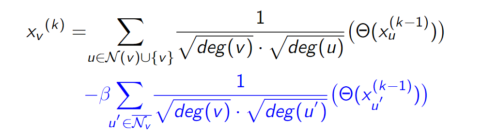
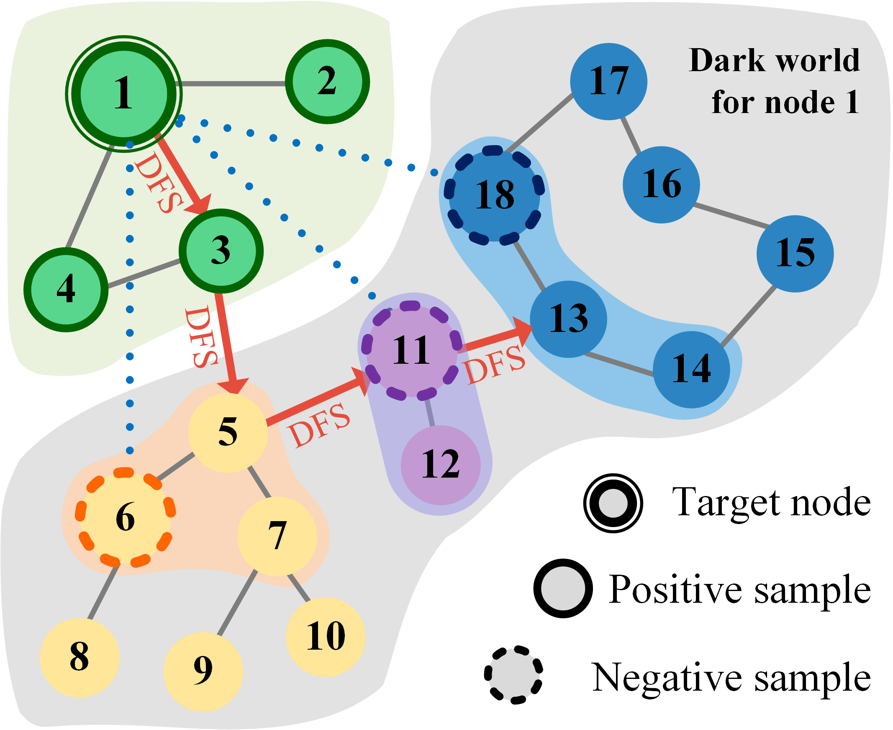
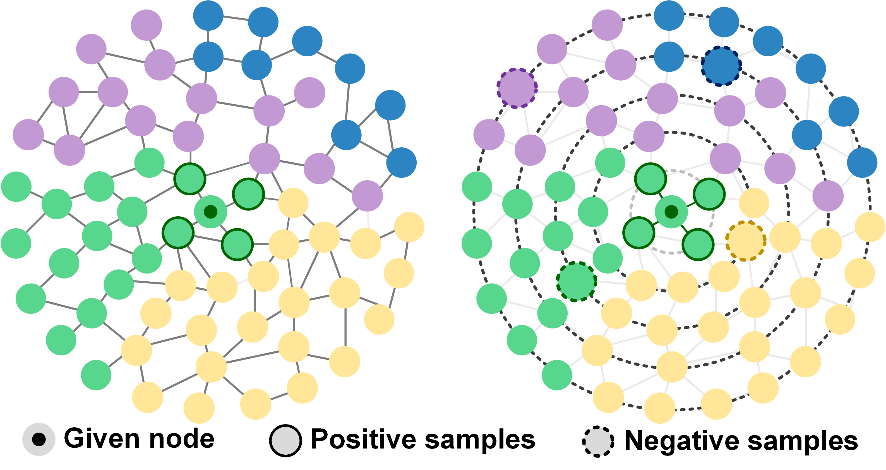
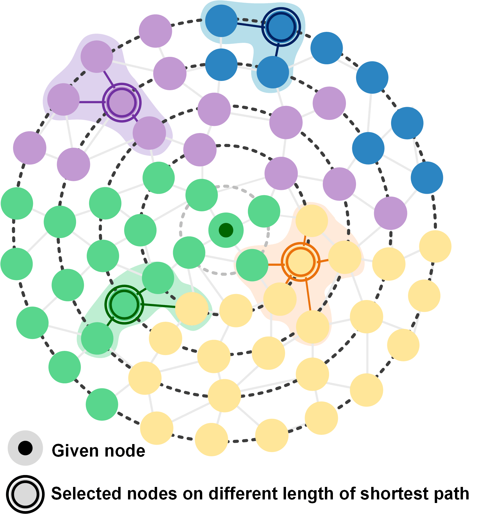
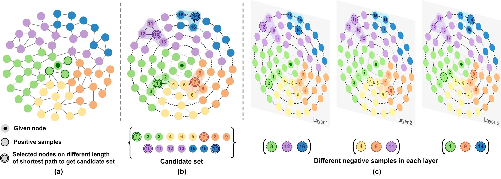

# Negative Samples-enhanced Graph Convolutional Neural Networks
Graph Convolutional Neural Networks (GCNs) have been generally accepted to be an effective tool for node representation learning. An interesting way to understand GCNs is to think of them as a message-passing mechanism where each node updates its representation by accepting information from its neighbours (also known as positive samples). However, beyond these neighbouring nodes, graphs have a large, dark, all-but-forgotten world in which we find the non-neighbouring nodes (negative samples).

We are the first to fuse negative samples into the graph convolution, yielding several new GCNs boosted by negative samples to improve the quality of node representations and alleviate the over-smoothing problem.

This repository is the official implementation of several methods to obtain negative samples and put them into convolutional operation, which can run directly on Google Colab.

The vector form of a layer in Negative Samples-enhanced Graph Convolutional Neural Networks can be defined as this:

<div align = center></div>


where $\overline{{\mathcal{N}}_{i}}$ 
is the negative sample of node 
$i$ 
and 
$\beta$ 
is a hyper-parameter to balance the contribution of the negative samples.

| # | Model | Venue | Code |
| --- | --- | --- | --- |
| 1 | [NegGCN (MCGCN)](#1-neggcn-mcgcn-) | ISKE 2021 | [1NegGCN](1NegGCN) |
| 2 | [D2GCN (DFS-DPP-GCN)](#2-d2gcn-dfs-dpp-gcn-) | AAAI 2022 | [2D2GCN](2D2GCN) |
| 3 | [SDGCN (Shortest path-DPP-GCN)](#3-sdgcn-shortest-path-dpp-gcn-) | IEEE TNNLS 2023 | [3SDGCN](3SDGCN) |
| 4 | [LDGCN (Layer-diverse Negative Sampling)](#4-ldgcn-layer-diverse-negative-sampling-for-gnns) | TMLR 2024 | [4LDGCN](4LDGCN) |


# 1. NegGCN (MCGCN) [](https://colab.research.google.com/drive/1HuIDqZHDZutKRzwH4menhgYVEQsjun9a?usp=sharing)

The first method is based on Monte Carlo chains. The negative samples were sampled using the method in [Understanding Negative Sampling in Graph Representation Learning](https://arxiv.org/pdf/2005.09863.pdf)

This work [Negative Samples-enhanced Graph Convolutional Neural Networks](https://ieeexplore.ieee.org/document/9755440) appeared in the 16-th International Conference on Intelligent Systems and Knowledge Engineering  (ISKE 2021)

.jpg)

Mechanism of the negative sampling graph convolution}. The central node is 
$v=5$
and 
$f(\cdot)$
is graph convolution layer. Nodes 4, and 7 are directly linked with node 5 by real positive edges. Thus, positive sampling convolution is performed by $x_{pos}=f(4,7,5).$ 
Node 3, and 8 are negative sampled using MCNS methods, which are based on Markov chain Monte-Carlo methods and DFS, message passing to central node $v=5$ 
along virtual imaginary edges, then negative sampling convolution is performed by $x_{neg}=f(3,8).$ 
Given a certain negative rate $\beta$, 
we get the negative sampling graph convolution result of this layer, i.e. $x^{'} = x_{pos} -\beta x_{neg} $ 

# 2. D2GCN (DFS-DPP-GCN)  [](https://drive.google.com/file/d/1jYKH9KaozAewr56ttqxB3I_NsWLUKhnM/view?usp=sharing)
The second method is based on the Determinant Point Process (DPP). DPP helps to get good negative samples, which contribute negative information to the given node in contrast to its positive samples and include as much information as possible to reflect the variety of the dark world.

This work [Learning from the Dark: Boosting Graph Convolutional Neural Networks with Diverse Negative Samples](https://aaai-2022.virtualchair.net/poster_aaai4442) appeared in the 36-th AAAI Conference on Artificial Intelligence (AAAI 2022)

<div align = center></div>

The concept of DPP-based negative sampling. The target node is Node 1. Nodes 2, 3 and 4 are positive samples. Nodes 5-18 are the dark world of Node 1. The 4-length DFS path of Node 1 is {3, 5, 11, 13}, where {5, 11, 13} are the central nodes on the path in the dark world. With their first-order neighbouring nodes, they form the candidate set of DPPs, i.e.{5,6,7,11,12,13,14,18}. The selected negative samples from this set are 6, 11, and 18, which can be seen as virtual negative links to Node 1.

# 3. SDGCN (Shortest path-DPP-GCN) [](https://colab.research.google.com/drive/1fobrHmuNvnGvg-6ZlRIc1thfxc6uq4g-?usp=sharing)

The third method is based on the decomposed determinant point process. We used quality-diversity decomposition in determinant point processes (DPP) to obtain diverse negative samples. When defining a distribution on diverse subsets of all non-neighbouring nodes, we incorporate both graph structure information and node representations. Since the DPP sampling process requires matrix eigenvalue decomposition, we propose a new shortest-path-base method to improve the computational efficiency.

This work [GNNs with Diverse Negative Samples via Decomposed DPP](https://arxiv.org/abs/2212.02055) has been accepted by IEEE TNNLS on 30-Aug-2023.

<div align = center></div>

Illustration of the motivation of this work. Left: For a given node, its first-order neighbours can be seen as positive samples.  Right: We compute the shortest path of the given node to other nodes. Different path lengths form concentric circles with different radii. Using DPP to select negative samples from different circles can get nodes for different clusters.

<div align = center></div>

Taking the given point as the circle's centre, different path lengths form concentric circles with different radii. All reachable nodes $V_{r}$ can be divided into different sets $N_{l}$ based on the path length. We choose a random point in the node-set $N_{l}$ of each length for starting $l = 2$, and the selected nodes and their first-order adjacent nodes become the candidates set $S_i$

# 4. LDGCN (Layer-diverse Negative Sampling for GNNs)

The fourth method is **layer-diverse DPP sampling**. Previous negative-sampling methods treat the samples in each GNN layer as independent, so the selected nodes still contain a large amount of redundancy across layers (more than 75% overlap in prior DPP-based models). LDGCN uses the sampling matrix in a determinantal point process to map the candidate set into a space, then applies **space squeezing** so that dimensions corresponding to the previous layer's negative samples are suppressed. This reduces the chance of selecting the same nodes again and covers more of the graph with fewer samples.

These negative samples are used in message passing, yielding Layer-diverse GCN (**LDGCN**). The same sampler also works with GATv2, GIN, and GraphSAGE.

This work [Layer-diverse Negative Sampling for Graph Neural Networks](https://openreview.net/forum?id=WOrdoKbxh6) has been accepted by *Transactions on Machine Learning Research* (TMLR) in 2024. ([arXiv](https://arxiv.org/abs/2403.11408))

Code: [4LDGCN](4LDGCN)

```bash
python LDGCN.py --dataset Cora --sample_rate 0.1 --num_layers 4

# Large OGB graphs
cd ogbn
python LDGCN_arxiv.py --sample_rate 0.001 --num_layers 4
python LDGCN_mag.py --sample_rate 0.001 --num_layers 4
```

<div align="center"></div>

Negative samples from layer-diverse DPP sampling. (a) For a given node in a graph, its first-order neighbours can be thought of as *positive samples*, despite the fact that these neighbours may belong to different clusters. (b) The shortest-path algorithm calculates the shortest path from a given node to other nodes in the graph to obtain smaller, yet more efficient candidate sets for further sampling. (c) As the candidate set is significantly larger than the number of negative samples needed, the ideal subset of negative samples is not unique. By using the layer-diverse DPP sampling method to select negative samples, it is possible to include as much information from the entire graph as possible while also reducing redundancy among negative samples in different layers.

## Citation

```bibtex
@article{duan2024layerdiverse,
  title={Layer-diverse Negative Sampling for Graph Neural Networks},
  author={Duan, Wei and Lu, Jie and Wang, Yu Guang and Xuan, Junyu},
  journal={Transactions on Machine Learning Research},
  year={2024},
  url={https://openreview.net/forum?id=WOrdoKbxh6}
}
```

